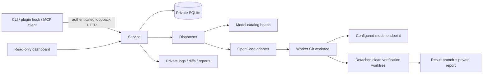

# Agent Spillway architecture

Status: Phase 0/1 implementation, 2026-10-12. Specification: [design.md](design.md). The owner's execution request authorizes independent routine choices and subagent implementation. The specification's §14 limits this delivery to Phase 0/1. Later-phase features are designed for, not silently implemented or claimed complete.

## Goals and boundaries

One user, one controller, one durable queue, one inference slot. Bank precise tasks, execute through an existing CLI harness, independently verify commits, preserve result branches for owner inspection. No agent tool loop, automatic merge, deployment, hosted dependency, telemetry, frontend build chain, or hostile-code sandbox.

## Components and ownership

- `contracts.ts`: shared TypeScript contracts. Parser/config validate unknown input; do not trust casts at boundaries.
- `task.ts`, `config.ts`, `store.ts`: readiness lint, private registered repositories/profiles, transactional SQLite migrations and state transitions.
- `process.ts`, `git.ts`, `harness.ts`, `verify.ts`: bounded subprocess groups, immutable base/result SHAs, endpoint probing, external harness, scope enforcement and checks.
- `controller.ts`: admission/data policy, one-attempt dispatch, recovery, review gate, reporting. Sole architectural policy authority.
- `server.ts`: authenticated loopback API and escaped server-rendered dashboard. `client.ts`, `cli.ts`, `mcp.ts`, plugin: stateless clients.

## Runtime and dependencies

TypeScript ESM on Node >=22.13, with built-in `node:sqlite` (experimental on older supported Node versions; tested on Node 22/24 in CI). Synchronous SQLite is appropriate for a single small queue; subprocesses and networking are asynchronous. YAML and Zod validate input; picomatch supplies documented POSIX glob behavior; MCP SDK supplies stdio protocol. Node HTTP and HTML avoid a web framework. Vitest, TypeScript and ESLint provide verification. Pin resolved dependencies in the lockfile. OpenCode is externally installed and version checked, not embedded.

OpenCode is provisional until a real endpoint spike compares two harness candidates. The owner has no endpoint yet and explicitly authorizes fixture testing. Fake harness and mock catalogs prove plumbing only. Never publish qualification claims from them.

## Storage and migrations

Default config `~/.config/spillway/config.yaml`; default data `~/.spillway/`. Private directories mode 0700, files 0600. Refuse data directories within any registered target Git repository or Spillway checkout. Worktrees and all transcripts/artifacts belong under the data directory. Allow external temporary paths for tests. No runtime state goes into target repositories beyond Git metadata and result branch refs.

Migration v1 has tasks, dependencies, attempts, and events plus `PRAGMA user_version`; v2 adds the controller lease. Tasks retain normalized spec and original Markdown. Attempts retain exact base SHA, endpoint/profile/model/harness version, start/end times, outcome, worktree and artifact paths, immutable verification/report data; events record phase transitions. Final attempt outcome, task state and review tier commit atomically. Events are transactionally appended in SQLite; Phase 3 adds JSONL via an outbox, avoiding dual-write inconsistency. WAL, foreign keys, busy timeout and explicit transactions. A transactional PID/nonce controller lease prevents competing services and `run --once`; clients never open SQLite. Stale claim and nonce replacement serialize under BEGIN IMMEDIATE.

## Admission and dispatch

Repository paths are canonicalized and must match an explicitly registered repository. `local-only`, `open-weight-hosted-ok`, `frontier-ok` form increasing permissions; endpoint kind is explicit, never inferred from its URL. A profile must list the task class as qualified and match the installed harness version. Reject design tasks. Risky classes and scope/diffs that include authentication, manifests, locks, CI or migrations force frontier review. No checks requires a justification and frontier review.

Defaults stay local review, per spec. Phase 1 has no model review implementation: verified local/frontier tasks hold with an explicit pending-review reason. Only an explicitly selected checks-only task permitted by config can become ready. Test weakening flags also force frontier and hold. No owner acceptance of held tasks. This prevents a walking skeleton from weakening the final acceptance contract.

Dependencies must be accepted AND their recorded result commit be an ancestor of the newly resolved base. Otherwise tasks wait. Missing dependencies and cycles are rejected at admission. Resolve base to exact commit at dispatch; work starts on `spillway/<id>` and commits must descend from base. An unhealthy or busy endpoint updates a visible queued reason and consumes no attempt. Transport outcomes allow exactly one retry, tracked separately, then hold. Coding failures fail/hold without automatic repair in Phase 1; Phase 2 owns bounded repair/escalation.

## Verification and recovery

Do not accept a harness success claim. Require current branch, clean tracked/untracked worktree, an actual new commit descending from recorded base, and unchanged result ref throughout verification. Detect both sides of renames, deleted files, symlinks and changed paths using NUL-delimited Git output. Protect explicit acceptance fixtures, conservatively flag removed/skipped tests and reduced assertion counts. Run owner-authored shell checks in a second detached clean worktree, with a minimal environment and time budget. Record outputs, exit codes and durations. Dependency installation is explicit in checks; never trust worker-installed dependencies.

Timeout kills the subprocess group, escalating TERM to KILL. Restart under the controller lease marks in-flight attempts uncertain, inspects the worktree, and conservatively holds it. SIGKILL may leave an orphan harness alive, so the entire dispatch slot pauses while execution remains uncertain. `inspect` reports worktree state without executing it. After stopping surviving workers, the owner explicitly runs `reconcile ID --worker-stopped`; this abandons the interrupted task, preserves its evidence, and releases the fence. Never automatically rerun uncertain work or reuse its result; bank a new ID. Worktree removal uses exact managed paths only; never discard a dirty worker checkout.

## API and security

Loopback only (`127.0.0.1`), no remote viewing this milestone. Generate a private bearer token and service descriptor under data. CLI and MCP read that descriptor. Authenticate all API operations, reject foreign Origin and Host headers, bind no CORS, cap request bodies, validate IDs, and resolve artifact IDs from stored allowlisted paths. Reject selected-file and managed-directory symlink substitution. Dashboard is read-only: exchange initial token for an HttpOnly SameSite cookie restricted to a fresh 256-bit `/view/<secret>/` path, then redirect away from the token query. Cookies share loopback across ports, so the random prefix is required; ordinary APIs accept bearer authentication only. Escape specs/diffs/logs as text; strict CSP, no third-party scripts or CDN. Authenticate dashboard and artifacts as well as APIs to avoid leaking private code to other local users. Checks and harnesses run with the owner's OS privileges: this is not isolation. Use a dedicated OS account/container for stronger isolation. Don't inherit provider keys into checks or logs. Redact configured credentials from harness output.

## Errors, logging and operations

API errors `{error:{code,message}}`, safe messages and correct 4xx/5xx status. Detailed subprocess logs remain private. Reports always distinguish transport/coding/check/policy failures and missing usage. Versioned service descriptor/protocol compatibility check. Foreground `serve` is Phase 1 operational mode; `run --once` temporarily runs the same service/controller for scripting. launchd/systemd install is Phase 2. Shutdown stops new work and terminates active process groups; recovery records uncertain attempts. No spending, production calls, release tags or package publication in this milestone.

## Verification strategy

Real disposable Git repositories + child-process fixture harness + HTTP mock catalog; no fake Git operations. Parser/config rejection and database transactions; adapter command/config contract tests; committed/dirty/out-of-scope/protected/rename/test weakening checks; clean-checkout proof; endpoint outage and transport budget; data policy; sequential dispatch; restart and actual process interruption; API auth/XSS/path traversal; CLI and stdio MCP; plugin manifest/hook smoke. CI uses Node 22/24 Linux and Node 24 macOS plus secret scanning. Real endpoint qualification, two-harness comparison, Claude plugin live loading and clean-machine onboarding remain explicit external gates.
