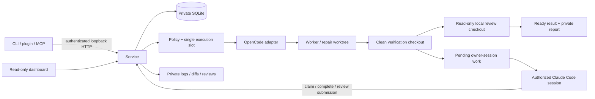
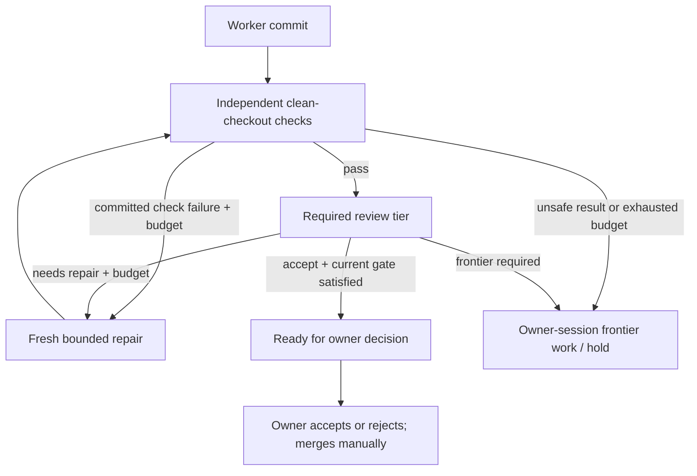
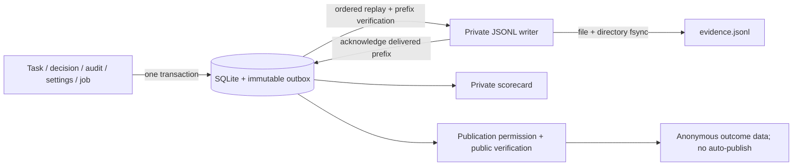

# Agent Spillway architecture

Status: Phase 3 implementation, 2026-10-12. Primary specification: [design.md](design.md). Phase 0/1 landed in PR #1 (main `1ab2878`). The owner then explicitly authorized Phase 2 and chose Claude Code sessions for frontier work, with no automatic paid calls. [PHASE2.md](PHASE2.md) records that authorization and the implementation handoff; [INTERFACES.md](INTERFACES.md) describes the consolidated contracts. The owner subsequently requested PR #2 merge and Phase 3 implementation; [PHASE3.md](PHASE3.md) freezes this wave after main merge `079478a`. Release and Phase 4/5 capabilities remain gated.

## Goals and boundaries

One user, one controller, one durable queue, one inference slot shared by workers, reviewers, owner-session claims and qualification jobs. Bank precise tasks, execute through an existing CLI harness, independently verify commits, and preserve result branches for owner inspection. No custom model/tool loop, automatic merge or push, deployment, mandatory hosted dependency, telemetry, frontend build chain, or hostile-code sandbox.

## Components and responsibilities

- `contracts.ts`: shared types. `task.ts`, `config.ts`, `policy.ts` validate input and effective policy; `credentials.ts` resolves explicit credential references without discovering account credentials.
- `store.ts`, `evidence.ts`: private SQLite migrations/outbox, atomic decisions/audits/jobs, controller lease, immutable evidence and crash-safe JSONL delivery.
- `process.ts`, `git.ts`, `harness.ts`, `verify.ts`: bounded subprocesses, managed worktrees, pinned commits, OpenCode invocation and independent checks.
- `review.ts`: strict report parser and local review in a separate detached checkout, with mutation detection and private artifacts.
- `controller.ts`: sole policy authority for admission, dispatch, budgets, dependencies, review/readiness, owner-session handoffs and acceptance.
- `server.ts`: authenticated loopback API and escaped read-only dashboard. `client.ts`, `cli.ts`, `mcp.ts` and the plugin are thin clients.
- `service-manager.ts`: reversible per-user launchd/systemd installation and lifecycle management; no root service or infrastructure provisioning.
- `report.ts`, `export.ts`: pure scorecards and a closed public outcome projection with explicit publication permission.
- `qualification.ts`: pinned tool workload and real/fixture provenance under the same durable execution slot.

## Runtime and integrations

TypeScript ESM on Node >=22.13, with built-in `node:sqlite` (experimental on older supported Node versions; CI covers Node 22/24). Synchronous SQLite suits one small queue. YAML and Zod validate input; picomatch supplies POSIX glob matching; the MCP SDK supplies stdio protocol. Node HTTP and server-rendered HTML avoid a web framework. Vitest, TypeScript and ESLint verify behavior. Pin resolved dependencies in the lockfile.

OpenCode is externally installed and version checked. The initial adapter was chosen after a real LM Studio toy-task comparison with Aider ([spike](spikes/real-harness.md)). Those toy results do not establish broader model qualification. Profiles bind exact model/artifact, endpoint, harness version and qualified classes; no automatic provider/model fallback. Health checks require the exact model in the configured OpenAI-compatible catalog. Unhealthy endpoints leave work pending and consume no attempt.

Local workers/reviewers may use a configured local endpoint or explicitly approved hosted open-weight endpoint, subject to the repository's data policy. Automatic frontier endpoint calls are disabled. Frontier work occurs only through an authorized Claude Code session exchanging packets with the local service; provenance is owner-attested, not proof of vendor/model identity.

## Private storage and migrations

Default config is `~/.config/spillway/config.yaml`; default data is `~/.spillway/`. Private directories use 0700 and files 0600. Canonical paths must keep config, state and evidence outside Spillway and target repositories; reject data under any Git checkout. Worktrees, prompts, transcripts, reports and logs live under the data directory. Target repositories receive only Git metadata and managed result branch refs.

Migration v1 creates tasks, dependencies, attempts and events; v2 adds the PID/nonce controller lease; v3 adds explicit task `nextAction`, attempt kind/parent lineage, reviews and frontier settings/audit records. Upgrades preserve original specs, timestamps and attempt evidence. Infer pending review only from held completed verified results; never revive terminal or uncertain execution. JSON fields remain JSON TEXT. WAL, foreign keys, a busy timeout and `BEGIN IMMEDIATE` transactions enforce consistency. Migration v4 adds admission/readiness metadata, immutable reviewer binding snapshots, decisions, audits, planning usage, qualification jobs and the transactional evidence outbox. JSONL is a delivered projection, not a second authoritative write.

Attempt finalization and review finalization commit evidence, task state/action, review strengthening and events atomically. Finalized and uncertain evidence cannot be rewritten. Repairs record their committed parent and original base SHA. A single transactional slot covers running attempts, reviews and qualification jobs; the service lease also prevents competing controllers. Stale lease replacement is serialized; nonce-specific release cannot remove a replacement lease.

## Policy, dispatch and continuation

Repositories must be registered by canonical Git root. `local-only`, `open-weight-hosted-ok`, `frontier-ok` form increasing permissions; endpoint kind is explicit, never inferred from a URL. Policy v1 covers all six task classes. Defaults follow design §6: tests, small-fix, mechanical and small-feature permit local execution and require local review; risky requires frontier review and defaults to a frontier-session worker; design tasks are rejected. Configuration cannot make design locally eligible or weaken risky review. Qualification and exact harness-version checks still apply to local workers and reviewers.

No-check tasks require a justification and frontier review. Sensitive scope/diffs, manifests, locks, CI, migrations, authentication and test-weakening flags force frontier review. Checks-only requires explicit global opt-in and is checked again at dispatch/readiness/owner decision. Review requirements may strengthen, never weaken. A separately configured reviewer profile must be local or hosted open-weight; the repository's data policy and class qualification apply independently to that binding.

Both local dispatch and frontier claims require dependencies to be accepted in the same repository and their recorded result commit must be an ancestor of the resolved base. Record the exact base at dispatch. Admission order is durable even when tasks share a timestamp. Home-relative task repository paths resolve from the operating-system user home, including in the daemon’s clean environment. Task actions (`worker`, `repair`, `review`, `frontier-worker`, or null) drive continuation; reasons are display text, not routing instructions.

Local repair is bounded by both task `max_attempts` and policy `max_repairs` (0 or 1). Repair starts from a committed result, keeps the original base for cumulative scope/protected checks, and receives failing checks, review findings and the diff. Archive the previous branch while retaining its checkout/evidence. Transport failures get exactly one free retry per task and do not consume the coding budget; a repair retry retains the latest non-transport committed source. Coding outcomes cannot be skipped to reuse an older repair parent. Repeated transport failures and exhausted budgets hold or schedule owner-session work. There is at most one frontier-session worker attempt per task; unsuccessful frontier verification or exhausted requested repair holds without a loop.

Frontier availability starts off. Manual changes and optional ISO-offset reset scheduling are persisted and audited in SQLite. Reading a due reset switches off to on at that exact instant; it does not initiate a provider call. Frontier packets/claims require both availability and `frontier-ok`. Local work can continue while frontier work holds. Claiming allocates a managed worktree and durable running attempt; completing invokes independent verification, followed by required frontier review. Owner claims and review conclusions never bypass checks.

## Verification and reviews

Worker success claims are not acceptance evidence. Require the expected branch, clean tracked/untracked checkout, a new commit descending from the recorded base, and an unchanged result ref. Inspect NUL-delimited changed paths, both sides of renames, deletions and symlinks. Enforce scope/protected paths, conservatively flag weakened/deleted tests, then run trusted owner checks in a separate detached clean checkout with a minimal environment and bounded time. Worker-installed dependencies are not trusted; installation must be explicit in checks.

Local review uses an independent `review-<id>` detached checkout and a dedicated OpenCode agent that permits read/glob/grep and denies mutation, shell commands, network tools and delegation. Refuse symlinks in that checkout. Verify the worker result and reviewer HEAD/status before and after execution, including untracked/ignored residue. Tool policy is defense in depth, not OS isolation. Mutation or uncertain cleanup preserves evidence and fences further execution.

Review packets include the pinned result, cumulative diff, independent check results/output, task and shared rubric. Task/file/log text is untrusted evidence. The complete local prompt is bounded at 128 KiB; do not silently truncate evidence. Reports require exact 40/64 lowercase hex SHA, strict known fields, at most 50 findings and messages up to 4000 characters; an accepting verdict cannot contain blocking findings. Raw JSON or one complete JSON fence is accepted; malformed, duplicate-key, truncated, timed-out or missing reports hold. Default review timeout is 10 minutes, configurable from 1 to 30.

The current required tier must approve the latest verified commit before readiness/owner acceptance. If policy strengthens after a local accepting review, preserve that report but hold for frontier review. Frontier submission rechecks availability, repository permission, result pinning and strict report validity. A rejected review fails; a repair request uses only the remaining budget. Review advice never authorizes eligibility.

## Recovery and operations

Timeout terminates the subprocess group with TERM followed by KILL. Shutdown stops new work, cancels active processes and waits for controller idleness and evidence delivery before closing SQLite/releasing its lease. Restart marks interrupted workers/reviewers and qualification jobs uncertain, holds task parents with no pending action and globally pauses execution: SIGKILL may leave an orphan process alive. `inspect` executes no worker. After stopping surviving processes, the owner explicitly runs `reconcile ID --worker-stopped`; the task is abandoned and evidence stays immutable. Bank a new ID rather than reusing uncertain results.

`serve` remains the foreground development mode; `run --once` calls an active service or temporarily starts the same controller. Per-user managed services pin absolute Node/compiled CLI/config paths, run outside repositories, and write private service logs. launchd and systemd definitions escape values, start via `/usr/bin/env -i` with an explicit PATH, use restrictive umasks and bounded restart behavior, and never copy provider keys into definitions. Updates/uninstall touch only recognized Spillway service files, reject symlink/unrelated substitutions, and preserve config/data/worktrees. Real manager calls occur only through owner-triggered CLI lifecycle commands; tests inject fixture executors. macOS live behavior and Linux fixture/systemd validation are recorded separately from release onboarding.

An endpoint credential reference may name an environment variable or an owner-only regular key file, never both. Managed services clear inherited environment, so explicit private key-file references support authenticated local endpoints. Validate file/parent ownership and permissions, bounded content, no file symlink and paths outside Git; read with no-follow semantics and recheck metadata. Secrets stay out of persisted config values, service definitions and logs; redact configured credentials from harness output. No account credential discovery or automatic paid calls.

## API and security

Bind only `127.0.0.1`; no remote viewing this milestone. Private bearer token/service descriptor authenticate CLI and MCP; validate IDs, request schemas, JSON duplicate keys/nonfinite numbers, content type and body bounds. Reject foreign Origin/Host, provide no CORS, and authenticate artifacts. Dashboard scorecards, audit holds and endpoint health remain read-only: exchange its initial token for an HttpOnly SameSite cookie scoped to a fresh 256-bit `/view/<secret>/` path and immediately redirect away from the query token. Ordinary APIs require bearer authentication; browser cookies authorize only GET within that private prefix. Escape all specs/diffs/logs; strict CSP, no third-party resources.

Artifacts resolve from stored allowlisted paths, not caller filenames. Check containment, regular files and managed directories; reject symlink/hardlink substitution. Harnesses and owner-authored checks still run with the owner's OS privileges. Spillway is not a sandbox; use a dedicated OS account/container for stronger isolation.

API errors use `{error:{code,message}}` with safe messages/status. Detailed private artifacts retain failure evidence. Attempt/review records distinguish transport, coding, check, policy and review failures; missing usage remains missing, not estimated. Protocol/version compatibility is checked by clients.

## Evidence, scorecards and deferred audits

SQLite v4 is the source of truth. Every task event, decision/audit update, planning entry, qualification job and frontier settings change appends a private immutable snapshot to an outbox in the same transaction. A rolled-back mutation leaves no evidence; a committed decision survives delivery failure. Identical state/tier updates are no-ops so waiting tasks do not generate repeated snapshots on every poll. Migration backfills one `legacy-snapshot` per existing task plus settings; it does not invent historical readiness, owner minutes, decisions or reviewer bindings.

`evidence.ts` projects ordered rows into private `evidence.jsonl`. A single writer per canonical directory operates under the production controller lease. It verifies the entire complete file prefix byte-for-byte against SQLite, streams 64 KiB chunks with a 16 MiB line bound, and recovers only an incomplete unacknowledged final line. Complete-write-before-ack replay verifies and acknowledges the existing row rather than appending a duplicate. Fsync the file and parent directory before acknowledging a prefix. Missing acknowledged bytes/file, a mismatched complete line, wrong queue directory or unsafe file/link/ownership fails closed without overwriting complete evidence. SQLite payloads stay available; safe pending/delivered/error health is visible and retried. Shutdown waits for delivery before closing SQLite.

At admission, record ordinary/qualification provenance and the effective policy snapshot. At readiness, record timestamp and observed frontier availability; legacy values remain unknown. Local reviews also snapshot the actual dispatched artifact/harness/version. Old reviews retain null metadata, preventing a later current profile from certifying historical execution. Worker/reviewer usage remains reported; never estimate missing tokens/costs.

Owner decisions require the latest independently verified pinned result and currently required accepting review. `recordDecision` atomically stores immutable optional owner minutes, accepted/rejected state, events, evidence and any selected audit. Reports distinguish owner decisions from successful workers/checks and preserve legacy unknowns. Ordinary scorecards exclude qualification tasks/jobs and show outcomes by class/profile, repair versus transport retry, requested versus executed escalation, phase timings, owner time and selected/completed/pending audits. Percentages require at least 20 observations. Phase timings may overlap (checks are inside verification); audit timing is request-to-submission turnaround, not measured model time.

Role usage separates planning, worker, review, escalation and audit. `frontierUsage` excludes service-local reviews; planning and owner-session usage are explicitly reported/attested. Field coverage counts show known versus missing input/output/cost observations and reported partial totals per accepted task. No quota/cost savings claim is made without a baseline.

Acceptance samples checks-only/local audits once with a Bernoulli draw (`audit_rate` 0..1, default .30); qualification and frontier-reviewed results are not selected. Audits denied by availability or repository permission stay visibly pending and remain in selected denominators. The service never launches an audit model. An authorized owner session obtains a packet tied to the accepted commit object and original passed verification; normal merging/removal of a result branch/worktree does not invalidate the audit. Reconstruct the diff from exact objects, never edited worker residue; reviewers must inspect those immutable objects or a clean detached checkout.

Packet/submission rechecks frontier availability and current `frontier-ok` after awaited preparation. Reports use the same strict exact-SHA schema; stale/replayed submissions are rejected. One immutable audit result belongs to each selected accepted task/result. Needs-repair/reject is a miss; accept with warnings is not a blocking miss. Audits append evidence but never rewrite acceptance, task state or original decision.

## Public export and qualification

Inference permission does not authorize publication. Export requires a separate explicit repository `publication.public_url` grant, absent/denied by default, matching a canonical public GitHub repository URL. Anonymous bounded verification uses only the fixed `api.github.com/repos/OWNER/REPO` endpoint, no credentials or redirects. Private/404/rate-limit/offline responses deny export. Recheck the publication grant after awaited verification; export only that registered repository's ordinary tasks.

`export.ts` builds a closed projection of outcome enums and finite numeric timings/check/usage/decision/audit data. Replace task/profile IDs with labels stable within that export. Do not include raw specs, prompts, commands, logs, errors, findings, paths, endpoint identities, private names, notes or timestamps. An explicit reviewed manifest may attach public model/artifact/version/license/context/hardware metadata; reject unknown/dangerous free text and binding mismatches. Missing metadata or missing historical reviewer snapshots remains unknown and `reproducible:false`. These are owner-reviewed metadata assertions, not proof that a server loaded specific weights. Export returns data/stdout only; it never publishes automatically.

`qualification.ts` runs the fixed Apache-2.0 `eval/workload-v1` through the existing harness, not a custom tool loop. Seven cases exercise discovery, read/search, structured edit, direct command execution, observed tool error/recovery, test-driven repair and multi-round context use. A SHA256 workload hash covers manifest/source/checks/tool fixtures. Each case creates a new private real Git repository, protects checks/docs/expected fixtures/tools, permits source-only changes and reuses independent verification. The whole case has a bounded budget; no arbitrary caller task or automatic repair loop is introduced.

Tool evidence must support actual operations on required paths/direct commands and their outputs/order. Multi-round requires at least three observed rounds and a full ledger read of at least 32,000 bytes; its target value exists only in the ledger, with a protected hash acceptance check. Missing/malformed/truncated streams or final claims alone cannot pass capabilities. Qualification explicitly requests temperature 0 and concurrency 1. OpenCode uses an explicit worker/reviewer primary, enabled custom-model temperature capability and zero sampling by default (finite input override supported). Auxiliary title/summary/subagent/batch inference and automatic compaction are disabled; worker task/skill tools are denied. Output limits are preserved and overflow fails. Installed-binary loopback wire smoke verifies actual requests/permissions; configuration serialization alone cannot prove these settings. Version/catalog/profile binding must match exactly, and this owner's qualification workflow permits local endpoints only.

Complete model artifact/license/server/hardware/quantization/settings metadata is explicitly operator-reported; requested temperature is separately recorded and must match metadata for a qualified claim. Missing metadata or any failed/held/timeout/uncertain case keeps the result observational. Fixture provenance can never qualify. Public community projection accepts only real, complete, passed `tool-workload-only` results and has empty `qualified_classes`: tool capability evidence does not establish coding-class acceptance. Never automatically promote configured classes, invent a first qualified profile or publish results.

Qualification CLI returns a durable job receipt before completion and inspects progress/results separately; execution remains service-owned under the slot after client disconnect. Synchronous HTTP remains compatible, with opt-in background admission. Shutdown awaits background runners before closing SQLite. Persist a `qualification_jobs` running row before any subprocess. Jobs share every worker/review active and uncertainty fence. Fsync private result file/directories before finalization; returned uncertain execution and unexpected exceptions retain uncertain status and globally block new inference. Restart marks running jobs uncertain. `qualify reconcile JOB-ID --worker-stopped` adds one immutable owner-stopped timestamp without rewriting the outcome/evidence. Invalid metadata is rejected before creating a job.

## Verification and release gates

Use disposable real Git repositories, subprocess fixture harnesses and HTTP mock catalogs; no credentials in CI or capability claims from fixtures. Verify v1–v4 migrations and rollback/outbox integrity, actual interrupted writes/replay/tail recovery, task/review/job fences, accurate missing-data/small-sample reports, immutable audit holds/races/replays after merge, publication deny/closed projection/historical binding privacy, pinned qualification tool evidence and fixture nonpromotion. Also retain policy/budget/dependency, authentication/XSS/artifact, CLI/MCP/plugin and service-manager checks. Critical authentication and data integrity changes receive independent review; full lint/type/tests/build and secret scans precede public push.

The isolated-home source/package smoke packs and installs build artifacts with lifecycle scripts disabled, validates CLI/MCP/plugin structure with a fixture service, and never invokes real service managers, credentials or paid inference. CI covers supported Node/Linux/macOS combinations. These checks do not substitute for live Claude marketplace/session loading or clean-OS onboarding. Real accepted ordinary pilot work, complete reproducible real metadata/qualification, owner-session operation and release onboarding remain explicit 0.1.0 gates. Version stays pre-alpha until those gates are met; automatic limit detection and Phase 4/5 remain later work.

Explicit evidence synchronization and shutdown capture the committed row-count watermark before joining any ongoing writer, then drain through that finite prefix (or return a visible delivery error). Joining a writer that started before a new owner decision must not report that decision synchronized prematurely. Later concurrent commits may remain pending; the operation does not chase an unbounded moving target.

Shutdown rejects new admissions and tracks HTTP route promises independently of sockets. A disconnected handler may still own asynchronous reads or a queue commit; every handler must settle before the final evidence drain and SQLite closure. Concurrent close callers await the same shutdown promise rather than resolving before completion.
