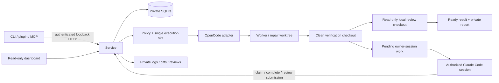
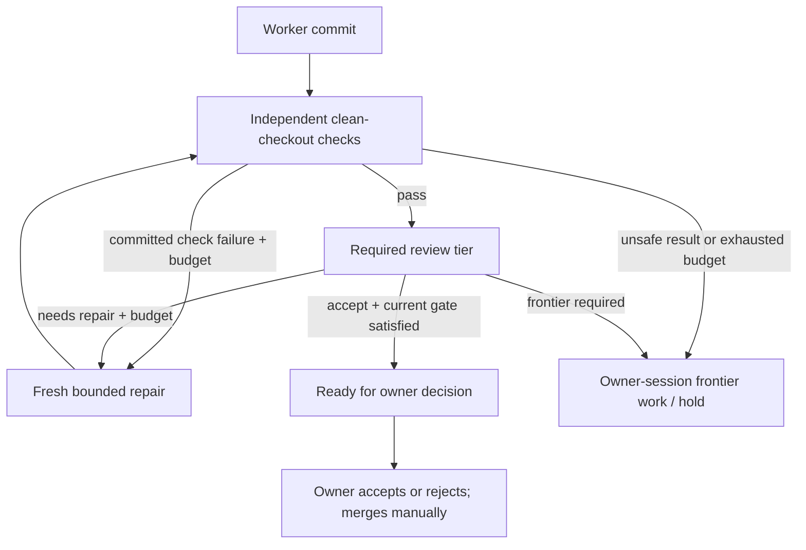

# Agent Spillway architecture

Status: Phase 2 implementation, 2026-10-12. Primary specification: [design.md](design.md). Phase 0/1 landed in PR #1 (main `1ab2878`). The owner then explicitly authorized Phase 2 and chose Claude Code sessions for frontier work, with no automatic paid calls. [PHASE2.md](PHASE2.md) records that authorization and the implementation handoff; [INTERFACES.md](INTERFACES.md) describes the consolidated contracts. Phase 3 scorecards, audits, export, qualification and release, and Phase 4/5 capabilities remain later work.

## Goals and boundaries

One user, one controller, one durable queue, one inference slot shared by workers, reviewers and owner-session claims. Bank precise tasks, execute through an existing CLI harness, independently verify commits, and preserve result branches for owner inspection. No custom model/tool loop, automatic merge or push, deployment, mandatory hosted dependency, telemetry, frontend build chain, or hostile-code sandbox.

## Components and responsibilities

- `contracts.ts`: shared types. `task.ts`, `config.ts`, `policy.ts` validate input and effective policy; `credentials.ts` resolves explicit credential references without discovering account credentials.
- `store.ts`: private SQLite migrations, controller lease, atomic state/action/evidence transitions, immutable finalized records and interruption fences.
- `process.ts`, `git.ts`, `harness.ts`, `verify.ts`: bounded subprocesses, managed worktrees, pinned commits, OpenCode invocation and independent checks.
- `review.ts`: strict report parser and local review in a separate detached checkout, with mutation detection and private artifacts.
- `controller.ts`: sole policy authority for admission, dispatch, budgets, dependencies, review/readiness, owner-session handoffs and acceptance.
- `server.ts`: authenticated loopback API and escaped read-only dashboard. `client.ts`, `cli.ts`, `mcp.ts` and the plugin are thin clients.
- `service-manager.ts`: reversible per-user launchd/systemd installation and lifecycle management; no root service or infrastructure provisioning.

## Runtime and integrations

TypeScript ESM on Node >=22.13, with built-in `node:sqlite` (experimental on older supported Node versions; CI covers Node 22/24). Synchronous SQLite suits one small queue. YAML and Zod validate input; picomatch supplies POSIX glob matching; the MCP SDK supplies stdio protocol. Node HTTP and server-rendered HTML avoid a web framework. Vitest, TypeScript and ESLint verify behavior. Pin resolved dependencies in the lockfile.

OpenCode is externally installed and version checked. The initial adapter was chosen after a real LM Studio toy-task comparison with Aider ([spike](spikes/real-harness.md)). Those toy results do not establish broader model qualification. Profiles bind exact model/artifact, endpoint, harness version and qualified classes; no automatic provider/model fallback. Health checks require the exact model in the configured OpenAI-compatible catalog. Unhealthy endpoints leave work pending and consume no attempt.

Local workers/reviewers may use a configured local endpoint or explicitly approved hosted open-weight endpoint, subject to the repository's data policy. Automatic frontier endpoint calls are disabled. Frontier work occurs only through an authorized Claude Code session exchanging packets with the local service; provenance is owner-attested, not proof of vendor/model identity.

## Private storage and migrations

Default config is `~/.config/spillway/config.yaml`; default data is `~/.spillway/`. Private directories use 0700 and files 0600. Canonical paths must keep config, state and evidence outside Spillway and target repositories; reject data under any Git checkout. Worktrees, prompts, transcripts, reports and logs live under the data directory. Target repositories receive only Git metadata and managed result branch refs.

Migration v1 creates tasks, dependencies, attempts and events; v2 adds the PID/nonce controller lease; v3 adds explicit task `nextAction`, attempt kind/parent lineage, reviews and frontier settings/audit records. Upgrades preserve original specs, timestamps and attempt evidence. Infer pending review only from held completed verified results; never revive terminal or uncertain execution. JSON fields remain JSON TEXT. WAL, foreign keys, a busy timeout and `BEGIN IMMEDIATE` transactions enforce consistency. Phase 3 JSONL will use an outbox rather than inconsistent dual writes.

Attempt finalization and review finalization commit evidence, task state/action, review strengthening and events atomically. Finalized and uncertain evidence cannot be rewritten. Repairs record their committed parent and original base SHA. A single transactional slot covers running attempts and reviews; the service lease also prevents competing controllers. Stale lease replacement is serialized; nonce-specific release cannot remove a replacement lease.

## Policy, dispatch and continuation

Repositories must be registered by canonical Git root. `local-only`, `open-weight-hosted-ok`, `frontier-ok` form increasing permissions; endpoint kind is explicit, never inferred from a URL. Policy v1 covers all six task classes. Defaults follow design §6: tests, small-fix, mechanical and small-feature permit local execution and require local review; risky requires frontier review and defaults to a frontier-session worker; design tasks are rejected. Configuration cannot make design locally eligible or weaken risky review. Qualification and exact harness-version checks still apply to local workers and reviewers.

No-check tasks require a justification and frontier review. Sensitive scope/diffs, manifests, locks, CI, migrations, authentication and test-weakening flags force frontier review. Checks-only requires explicit global opt-in and is checked again at dispatch/readiness/owner decision. Review requirements may strengthen, never weaken. A separately configured reviewer profile must be local or hosted open-weight; the repository's data policy and class qualification apply independently to that binding.

Both local dispatch and frontier claims require dependencies to be accepted in the same repository and their recorded result commit must be an ancestor of the resolved base. Record the exact base at dispatch. Admission order is durable even when tasks share a timestamp. Home-relative task repository paths resolve from the operating-system user home, including in the daemon’s clean environment. Task actions (`worker`, `repair`, `review`, `frontier-worker`, or null) drive continuation; reasons are display text, not routing instructions.

Local repair is bounded by both task `max_attempts` and policy `max_repairs` (0 or 1). Repair starts from a committed result, keeps the original base for cumulative scope/protected checks, and receives failing checks, review findings and the diff. Archive the previous branch while retaining its checkout/evidence. Transport failures get exactly one free retry per task and do not consume the coding budget; a repair retry retains the latest non-transport committed source. Coding outcomes cannot be skipped to reuse an older repair parent. Repeated transport failures and exhausted budgets hold or schedule owner-session work. There is at most one frontier-session worker attempt per task; unsuccessful frontier verification or exhausted requested repair holds without a loop.

Frontier availability starts off. Manual changes and optional ISO-offset reset scheduling are persisted and audited in SQLite. Reading a due reset switches off to on at that exact instant; it does not initiate a provider call. Frontier packets/claims require both availability and `frontier-ok`. Local work can continue while frontier work holds. Claiming allocates a managed worktree and durable running attempt; completing invokes independent verification, followed by required frontier review. Owner claims and review conclusions never bypass checks.

## Verification and reviews

Worker success claims are not acceptance evidence. Require the expected branch, clean tracked/untracked checkout, a new commit descending from the recorded base, and an unchanged result ref. Inspect NUL-delimited changed paths, both sides of renames, deletions and symlinks. Enforce scope/protected paths, conservatively flag weakened/deleted tests, then run trusted owner checks in a separate detached clean checkout with a minimal environment and bounded time. Worker-installed dependencies are not trusted; installation must be explicit in checks.

Local review uses an independent `review-<id>` detached checkout and a dedicated OpenCode agent that permits read/glob/grep and denies mutation, shell commands, network tools and delegation. Refuse symlinks in that checkout. Verify the worker result and reviewer HEAD/status before and after execution, including untracked/ignored residue. Tool policy is defense in depth, not OS isolation. Mutation or uncertain cleanup preserves evidence and fences further execution.

Review packets include the pinned result, cumulative diff, independent check results/output, task and shared rubric. Task/file/log text is untrusted evidence. The complete local prompt is bounded at 128 KiB; do not silently truncate evidence. Reports require exact 40/64 lowercase hex SHA, strict known fields, at most 50 findings and messages up to 4000 characters; an accepting verdict cannot contain blocking findings. Raw JSON or one complete JSON fence is accepted; malformed, duplicate-key, truncated, timed-out or missing reports hold. Default review timeout is 10 minutes, configurable from 1 to 30.

The current required tier must approve the latest verified commit before readiness/owner acceptance. If policy strengthens after a local accepting review, preserve that report but hold for frontier review. Frontier submission rechecks availability, repository permission, result pinning and strict report validity. A rejected review fails; a repair request uses only the remaining budget. Review advice never authorizes eligibility.

## Recovery and operations

Timeout terminates the subprocess group with TERM followed by KILL. Shutdown stops new work, cancels active processes and waits for controller idleness before releasing its lease/descriptor. Restart marks interrupted workers and reviewers uncertain, holds parents with no pending action and globally pauses execution: SIGKILL may leave an orphan process alive. `inspect` executes no worker. After stopping surviving processes, the owner explicitly runs `reconcile ID --worker-stopped`; the task is abandoned and evidence stays immutable. Bank a new ID rather than reusing uncertain results.

`serve` remains the foreground development mode; `run --once` calls an active service or temporarily starts the same controller. Per-user managed services pin absolute Node/compiled CLI/config paths, run outside repositories, and write private service logs. launchd and systemd definitions escape values, start via `/usr/bin/env -i` with an explicit PATH, use restrictive umasks and bounded restart behavior, and never copy provider keys into definitions. Updates/uninstall touch only recognized Spillway service files, reject symlink/unrelated substitutions, and preserve config/data/worktrees. Real manager calls occur only through owner-triggered CLI lifecycle commands; tests inject fixture executors. macOS live behavior and Linux fixture/systemd validation are recorded separately from release onboarding.

An endpoint credential reference may name an environment variable or an owner-only regular key file, never both. Managed services clear inherited environment, so explicit private key-file references support authenticated local endpoints. Validate file/parent ownership and permissions, bounded content, no file symlink and paths outside Git; read with no-follow semantics and recheck metadata. Secrets stay out of persisted config values, service definitions and logs; redact configured credentials from harness output. No account credential discovery or automatic paid calls.

## API and security

Bind only `127.0.0.1`; no remote viewing this milestone. Private bearer token/service descriptor authenticate CLI and MCP; validate IDs, request schemas, JSON duplicate keys, content type and body bounds. Reject foreign Origin/Host, provide no CORS, and authenticate artifacts. Dashboard remains read-only: exchange its initial token for an HttpOnly SameSite cookie scoped to a fresh 256-bit `/view/<secret>/` path and immediately redirect away from the query token. Ordinary APIs require bearer authentication; browser cookies authorize only GET within that private prefix. Escape all specs/diffs/logs; strict CSP, no third-party resources.

Artifacts resolve from stored allowlisted paths, not caller filenames. Check containment, regular files and managed directories; reject symlink substitution. Harnesses and owner-authored checks still run with the owner's OS privileges. Spillway is not a sandbox; use a dedicated OS account/container for stronger isolation.

API errors use `{error:{code,message}}` with safe messages/status. Detailed private artifacts retain failure evidence. Attempt/review records distinguish transport, coding, check, policy and review failures; missing usage remains missing, not estimated. Protocol/version compatibility is checked by clients.

## Verification strategy

Use disposable real Git repositories, subprocess fixture harnesses and HTTP mock catalogs; no credentials in CI or capability claims from fixtures. Verify parser/config/policy rejection, v1/v2/v3 migrations and transactional rollback, lineage/budgets, sequential worker/reviewer dispatch, strict/stale/replayed review denial, actual interruption fences, data policy, authenticated owner-session routes, dashboard XSS/artifact containment, CLI/MCP/plugin routing and service-manager privacy/lifecycle. Critical authentication and data integrity changes receive independent review. Full type/lint/tests/build and secret scanning precede public push. CI covers Node 22/24 Linux and Node 24 macOS. Broader real qualification, reliable limit detection, live plugin loading and clean-machine release onboarding remain explicit external gates.
