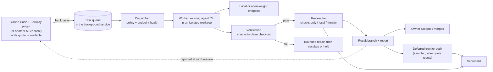

# Agent Spillway: keep coding when you hit your limits

*Naming: the project is **Agent Spillway**, shortened to "Spillway" in this document. The CLI command is `spillway`; the repository, npm package, and plugin marketplace are `agent-spillway`; the Claude Code plugin is `spillway`, so its commands read `/spillway:bank` (§7.10).*

Version: 0.3
Date: October 12, 2026
Owner: Curt Kline
Status: Design for initial implementation. Supersedes v0.2 ("Hybrid coding agent orchestration"), which proposed extending Horde.
Audience: the owner, an implementing coding agent (Claude Code or Codex), and future open-source contributors. This document is intended to live in the public repository as `docs/design.md`.

## 1. Summary

Heavy users of frontier coding agents regularly hit subscription usage limits. Agent Spillway (Spillway for short) is a small, open-source tool that does three things:

- Frontier agents bank well-specified coding tasks while quota is available, mainly through a Claude Code plugin that fits a design-in-Claude, hand-off-to-Claude-Code workflow.
- Local or low-cost open-weight models then work through those tasks, including while frontier accounts are capped.
- Every result passes objective checks and a configurable review tier, and a scorecard records whether the arrangement actually produces accepted work and conserves frontier usage.

Spillway is deliberately narrow: one machine, one queue, existing agent harnesses, and no distributed runtime. It has two parts:

- a **Claude Code plugin**, the everyday interface
- a small **background service** that does the work whether or not Claude Code is running

It is open source from the first commit, and the repository doubles as a Claude Code plugin marketplace, so installing Spillway takes one command from inside Claude Code. Its evaluation data, qualification suite, and hardware profiles are published as part of the project.

## 2. Goals

### Primary

1. **Headroom.** Keep useful coding work moving when frontier accounts hit limits, without upgrading to a higher subscription tier.
2. **Lower frontier usage.** Offload straightforward tasks to local or low-cost open-weight models, so frontier quota goes to planning, architecture, and difficult work.
3. **Open source.** Publish a reusable tool and open evaluation data that other developers with similar hardware can use and extend.

### Secondary

- Learn which task classes local models handle reliably, and which review tier each class actually needs.
- Enjoy building the tooling and learn from it.
- Keep the option of a product later, informed by real adoption rather than speculation (§7.9).

### Success looks like

- Work continues during frontier limit periods, measured as accepted tasks completed while capped.
- For at least one task class, local execution with a non-frontier review tier yields owner-accepted work, with an audited miss rate the owner finds acceptable.
- For those classes, frontier usage per accepted task is lower in the hybrid workflow than in a frontier-only workflow. The comparison includes planning and audits.
- Another developer can install Spillway, point it at their own endpoint, and complete a sample task by following the README.

### Non-goals for v0.x

Multi-user or team features, distributed or remote runtimes, a hosted or multi-user web application (a local status dashboard is in scope; see §5.10), model training, automatic merge to main or deployment, a general-purpose agent framework, a custom agent tool loop, and a hostile-code sandbox.

## 3. Design principles

- **Bank while you can.** Frontier models do the thinking when quota is available and write it down as executable tasks. Execution does not depend on frontier availability.
- **Fit the existing workflow.** The owner designs in Claude and hands off to Claude Code; Claude Code delegates suitable tasks through the plugin. Spillway should not require a new way of working.
- **Reuse harnesses.** Workers run existing agent CLIs against an OpenAI-compatible or Anthropic-compatible endpoint. Spillway does not implement its own tool loop.
- **Deterministic policy.** Rules in versioned config decide eligibility, review tier, retries, and escalation. Model judgment may advise; it never authorizes.
- **Checks are authoritative, workers are not.** A worker saying "done" is not evidence. Acceptance comes from checks run by Spillway in a clean checkout, plus the task's review tier.
- **Small surface.** One background service (SQLite, Git worktrees, and a local dashboard), a thin Claude Code plugin, a CLI, and an MCP server. Add components only when a measured problem requires them.
- **Open by default.** Code, docs, evaluation tasks, qualification results, and design decisions are public. Private material is confined to local config and data directories outside the repository.

## 4. How it works



A typical day:

1. **Bank.** The owner designs in Claude and hands off to Claude Code as usual. Using the Spillway plugin, Claude Code does three things:
   - identifies the parts of the handoff suited to delegation
   - writes them as tasks local models can finish (§5.1) and banks them
   - continues with the work that needs a frontier model

   Banking happens up front, while quota is available. Once an account is capped, Claude Code can't delegate either.
2. **Drain.** The dispatcher runs local-eligible tasks one at a time against the configured endpoint. This happens whether or not frontier quota is available; local execution conserves quota by default.
3. **Verify and review.** Each result is verified, reviewed at its tier, and left on a result branch with a report.
4. **Hold when capped.** When a frontier account hits its limit, frontier-tier work holds instead of failing and resumes after the reset. Frontier-tier work means frontier reviews, escalations, and audits. Optionally, a low-cost hosted open-weight model takes the planner role while frontier is capped.
5. **Audit.** After quotas reset, otherwise-unused frontier capacity runs sampled audits of work that was accepted without frontier review.
6. **Report back and accept.** At the start of the next Claude Code session, the plugin reports finished, failed, and held tasks. The owner, with Claude Code's help, reviews result branches and merges what is good. The scorecard summarizes what happened.

## 5. Components

### 5.1 Task specification

A task is a Markdown file with YAML frontmatter, readable by both humans and agents. Submitted tasks are stored in the queue database. Spec files may also live in the target repository if the owner wants.

```yaml
---
id: add-csv-export-tests       # generated if omitted
repo: ~/code/pilot-app          # registered repository
base: main                      # branch or commit; recorded as exact SHA at dispatch
class: tests                    # task class from policy (§6)
after: []                       # task IDs that must be accepted and merged first
scope:                          # files the worker may change (globs)
  - src/export/**
  - tests/export/**
protected:                      # files the worker must not change
  - tests/fixtures/acceptance/**
context:                        # files the worker should read first
  - src/export/csv.ts
  - docs/export.md
checks:                         # commands that must pass, run by Spillway
  - npm test -- tests/export
  - npm run lint
review: default                 # default | checks-only | local | frontier
limits:
  max_minutes: 30
  max_attempts: 2
---

## Objective
Add unit tests for CSV export covering quoting, empty rows, and Unicode.

## Acceptance criteria
- New tests fail against a deliberately broken quoting function and pass against the current one.
- No changes outside scope.

## Notes from planner
The quoting helper is csv.ts:escapeField. Do not refactor it.
```

**Task readiness checklist.** The planner skill enforces this checklist, and a `spillway lint` command checks the parts that can be checked mechanically:

- One objective, small enough to complete in one sitting. The initial guide is a handful of files.
- At least one runnable check that would fail if the task were not done. A task with no check needs an explicit justification and is forced to `review: frontier`.
- Explicit scope, with no open design decisions left to the worker.
- Listed context files, so the worker does not need to explore the whole repository.

Task quality is expected to be the largest single factor in local success, so it is measured (§9, E4).

### 5.2 Background service, queue, and state

The controller runs as a per-user background service (launchd on macOS, systemd on Linux), independent of any Claude Code session. MCP servers bundled in a Claude Code plugin run only alongside an open session. For work to continue while Claude Code is closed or capped, the following must live in this service:

- the queue and dispatcher
- verification
- audits
- the dashboard

The plugin, MCP server, CLI, and dashboard are all clients of the service over a local socket or localhost API, and none of them hold state.

State lives in SQLite in the data directory (default `~/.spillway/`), never inside a repository.

Task states: `queued → dispatched → verifying → reviewing → ready | needs-repair | escalated | held | failed | abandoned`. Owner action then moves a task to `accepted` or `rejected`.

Each dispatch creates an attempt record containing:

- endpoint, model profile, harness, and harness version
- exact base SHA
- start and end time, and exit status
- usage, where the harness reports it
- paths to log artifacts

On restart, any attempt that was mid-flight becomes `uncertain`. Spillway inspects the worktree and either resumes verification of committed work or marks the task `held` for owner inspection. It never silently re-runs an attempt.

### 5.3 Claude Code plugin and other entry points

The Claude Code plugin is the primary interface. A Claude Code plugin bundles skills, subagents, hooks, and MCP servers as one installable unit. The Spillway plugin contains:

- **Delegation skill** (`/spillway:bank`, which Claude can also invoke on its own). It covers when to delegate, the task format, the readiness checklist, and how to decompose a handoff for local execution. Claude Code judges what looks delegable, but the service's deterministic policy (§6) still decides eligibility and review tier.
- **MCP server.** A thin client of the background service, with tools `add_task`, `list_tasks`, `get_task`, `get_result`, and `queue_status`.
- **Session-start hook.** Summarizes finished, failed, and held tasks, so results flow back into normal sessions. Add other hooks only if they prove useful.
- **Reviewer subagent.** Performs frontier-tier reviews (§5.7) inside a Claude Code session, using the shared rubric.
- **Status and setup skills.** `/spillway:status` gives a summary plus the dashboard link. `/spillway:setup` checks that the service is installed and running, and guides installation with the owner's approval.

Delegation is asynchronous. Claude Code banks tasks and continues other work rather than waiting for local results.

**Keep the plugin small.** An enabled plugin places its skill, agent, and tool descriptions in the context of every session, and that counts against usage. For a tool meant to save quota, that overhead is a poor trade. Prefer a few well-described components, and measure the plugin's context footprint before each release.

Other entry points are thin clients of the same service:

- **CLI:** `spillway add task.md`, `spillway list`, `spillway show <id>`, `spillway accept|reject <id>`, plus service management. Used for scripting and outside Claude Code.
- **Standalone MCP server with AGENTS.md guidance**, for Codex and other MCP clients.
- **Dashboard** (§5.10).

### 5.4 Workers and harness adapters

A worker is an existing agent CLI run non-interactively in a fresh Git worktree on the controller, with inference on a configured endpoint. Spillway owns the worktree, the prompt (task spec plus context), time limits, and verification. The harness owns the tool loop.

Candidate harnesses:

- OpenCode
- Aider
- Codex CLI with a custom model provider
- Claude Code pointed at an Anthropic-compatible endpoint, if the server or a translation proxy exposes one

Phase 0 must verify each candidate for:

- non-interactive operation
- configuration of a custom OpenAI-compatible endpoint
- reliable tool calling with the chosen models
- machine-readable output and exit status

Start with one adapter. Illustrative interface (language per §13):

```ts
interface HarnessAdapter {
  id: string;                       // e.g. "opencode"
  version(): Promise<string>;
  run(input: {
    worktree: string;
    prompt: string;                 // rendered from task spec
    endpoint: EndpointProfile;
    timeoutSec: number;
    logPath: string;
  }): Promise<{
    exit: "completed" | "failed" | "timeout" | "transport_error";
    usage?: { inputTokens?: number; outputTokens?: number; costUsd?: number };
    summary?: string;               // worker's claim; never used as acceptance evidence
  }>;
}
```

Transport failures, such as an unreachable endpoint or a malformed stream, are recorded separately from coding failures. They get one retry and do not otherwise consume the task's attempt budget.

### 5.5 Endpoints and model profiles

An endpoint is a server URL plus a credentials reference, defined in private local config. A model profile binds an endpoint to an exact model artifact and settings, and records qualification results. Profiles are versioned YAML:

```yaml
id: example-coder-3090              # illustrative; real model chosen by qualification
endpoint: gaming-pc                 # name defined in private local config
server: { engine: llama.cpp, version: "<exact>" }
model: { name: "<exact>", artifact: "<hash or revision>", quant: "<quant>", license: "<license>" }
context: { tested_tokens: 32768 }
harness: { id: opencode, version: "<exact>" }
concurrency: 1
qualified_classes: [tests, small-fix]
qualified_on: 2026-10-20
known_failures: []
```

Spillway checks endpoint health before each dispatch: the catalog must be reachable and the profile's model present. An unhealthy endpoint makes its tasks wait, not fail. This matters for a GPU that is also used for gaming.

### 5.6 Verification

After the worker exits, Spillway does the following:

1. Requires the changes to be committed on the task's result branch (`spillway/<task-id>`). Uncommitted changes are captured as a diff artifact, and the attempt fails.
2. Rejects changes outside `scope` or touching `protected` paths.
3. Runs the `checks` in a separate clean checkout of the result commit, not in the worker's worktree, with a minimal environment.
4. Records the check output as artifacts.

A check failure triggers at most one bounded repair attempt, which receives the failing output and the current diff. If the repair also fails, the task escalates or holds, per policy.

### 5.7 Review tiers and deferred audits

| Tier | What happens | Intended for |
|---|---|---|
| checks-only | Verification only | Task classes with strong checks, once audits show low miss rates |
| local | Verification plus a local-model reviewer using a fixed rubric | Default for local-eligible classes during experimentation |
| frontier | Verification plus a frontier review | Risky classes, tasks without runnable checks, and escalations |

All tiers share one review rubric: requirement met, scope respected, tests meaningful (not weakened or trivial), obvious bugs, and security-sensitive changes. The review output is `accept`, `needs-repair`, or `reject`, plus findings.

Frontier reviews run in one of two ways: through the plugin's reviewer subagent during a Claude Code session, or by the service invoking a frontier harness non-interactively while frontier is marked available.

**Deferred audits.** A configurable fraction of tasks accepted at the checks-only or local tier are queued for frontier review after the fact. Audits run only when frontier capacity is available, for example after a quota reset or at a scheduled off-peak time.

- Audit findings never retroactively change a merged commit.
- They produce a report and feed the scorecard's estimated miss rate for each class and tier.

This is how the project tests whether straightforward tasks need frontier review.

### 5.8 Limit awareness

**MVP:** the owner sets frontier availability manually (`spillway frontier off|on`) or on a schedule. Frontier-tier work holds while availability is off.

**Later:** Spillway detects limits from its own frontier calls and flips availability automatically. Signals include harness exit status and usage-limit messages, with the reset time where one is provided; work resumes after the reported reset. Detecting limits hit in the owner's interactive sessions, for example through harness hooks, is a later investigation, not an MVP requirement. Phase 0 identifies which signals are reliable.

**Optional fallback planner:** a low-cost hosted open-weight model can be configured as the planner while frontier is unavailable, subject to the repository's data policy.

### 5.9 Scorecard and evidence

Evidence is stored as append-only JSONL plus SQLite in the data directory. For each task and attempt, it records:

- task class, profile, harness, and review tier
- attempts, repairs, and escalations
- timing: queue, run, verify, and review
- check results
- usage and cost where reported, kept separate from estimates, with missing values recorded as missing
- the owner's decision (accepted or rejected), owner minutes if entered, and audit findings
- whether the task completed while frontier was marked unavailable

`spillway report` prints:

- accepted tasks by class and profile
- the count of tasks accepted while capped
- acceptance and repair rates
- audit miss rate by tier and class, with sample sizes
- frontier usage per accepted task, broken down into planning, review, escalation, and audits

Small samples are shown as counts, not as percentages with false precision.

`spillway export --sanitized` produces a publishable dataset, for public repositories only (§7.5).

### 5.10 Local status dashboard

The controller serves a local web dashboard as the primary way to check status. The CLI remains for scripting and automation.

Views:

- **Queue:** tasks by state, with class, profile, age, and the reason for anything held or escalated.
- **Task detail:** spec, attempts, timing, check output, review findings, the result-branch diff, and links to log artifacts.
- **Frontier availability and endpoints:** current frontier on/off state with the expected reset time, plus endpoint health and current local slot usage.
- **Scorecard (Phase 3):** the `spillway report` measures as simple charts and tables, with counts shown alongside any rates.

Constraints that keep it small:

- **One source of truth.** The dashboard reads the same SQLite and JSONL data as the CLI. It never keeps its own state.
- **Read-only in v0.1.** Owner actions (accept, reject, retry, frontier toggle) stay in the CLI at first. Add a few action buttons only after the read-only view proves useful, and each must call the same core functions the CLI uses.
- **No frontend build chain.** Use server-rendered HTML or a single static page with plain JavaScript that polls a small JSON API every few seconds. Use a small charting library from a CDN, or bundle one, for scorecard charts. This keeps the dashboard easy for contributors to change.
- **Local by default.** Bind to `127.0.0.1`. Remote viewing, for example from a phone over a private network, is an explicit opt-in that requires a token. The dashboard shows code diffs and must never be exposed publicly.

## 6. Initial policy

Policy lives in versioned config. All values are starting points, to be tuned with evidence.

| Task class | Examples | Local eligible | Default review tier |
|---|---|---|---|
| tests | Add or extend unit tests for existing behavior | Yes | local |
| small-fix | Localized bug fix with a reproducing check | Yes | local |
| mechanical | Renames, lint fixes, type annotations, doc updates | Yes | local (early candidate for checks-only) |
| small-feature | Small, well-specified addition within one module | Yes, after qualification | local, with a higher audit rate |
| risky | Auth, secrets, permissions, data migrations, destructive data operations, dependency/manifest/lockfile changes, CI config | Frontier worker, or local with frontier review | frontier |
| design | Ambiguous, architectural, or cross-cutting work | No | Not a Spillway task; this is planner work |

Other defaults:

- **Attempts:** one attempt plus one repair on local before escalation.
- **Escalation:** the task is re-queued for a frontier worker, or held if frontier is unavailable. The handoff includes the task, the diff, and the check output, not the full transcript.
- **Time limits:** `max_minutes` per attempt defaults to 30. Queue wait has no limit for local work, but tasks older than a configurable age are flagged.
- **Audit rate:** initially 30% of local and checks-only accepts. Adjust per class with evidence.
- **Concurrency:** one local inference slot until measurements support more.
- **Never:** auto-merge to the base branch, push anywhere except result branches (pushing those is optional), or deploy.
- **Data policy per repository:** `local-only` (local endpoints only), `open-weight-hosted-ok`, or `frontier-ok`. Code never goes to a destination the repository's policy disallows, including for reviews, audits, and fallback planning.

## 7. Open source

Open source is a core goal, not a release step. The repository is public from the first commit.

### 7.1 Positioning

Spillway is a focused, single-machine tool for one problem: keeping coding work moving with local and low-cost models when frontier limits bite, with evidence about what actually works.

Horde (Hamster Research, Apache-2.0) is the closest existing project and a useful design reference. Horde offers durable multi-worker orchestration, fleets, and delivery pipelines. Spillway intentionally leaves those out, in favor of:

- a Claude Code plugin that fits an existing workflow
- a smaller surface
- queue-and-drain operation
- review-tier experiments
- open evaluation data

The README should describe Horde accurately and credit any ideas or code borrowed from it. Public comparisons with other projects should be factual and respectful.

### 7.2 License and legal

- **License:** Apache-2.0 for all original code and docs, with LICENSE and NOTICE in the first commit. It includes a patent grant and matches the surrounding ecosystem.
- **Adapted code:** any code adapted from Apache-2.0 projects keeps its notices and is listed in NOTICE.
- **Contributions:** accepted under the Developer Certificate of Origin (sign-off), with inbound = outbound licensing.
- **Product optionality:** Apache-2.0 lets the owner, and anyone else, build commercial offerings. If the owner might later want to relicense or dual-license contributed code, decide on a CLA before accepting substantial outside contributions (§13).
- **Third-party components:** model weights, hosted APIs, and harnesses are under their own terms. Profiles record licenses, but the repository does not redistribute weights.

### 7.3 Repository from day one

The first commit includes:

- README: pre-alpha status, what Spillway does and does not do, and a quick start once one exists
- LICENSE and NOTICE
- CONTRIBUTING: DCO, how to propose changes, and the project's scope
- SECURITY.md: private disclosure path and the trust model (Spillway is not a sandbox)
- CODE_OF_CONDUCT
- this document, as `docs/design.md`
- AGENTS.md / CLAUDE.md for coding agents working on the repository
- `.claude-plugin/marketplace.json` and the plugin directory (a skeleton at first; §7.8)
- `.gitignore` covering local config and data

Before the first push:

- Set up secret scanning: gitleaks (or equivalent) as a pre-commit hook and in CI, plus GitHub secret scanning with push protection.
- Keep credentials out of CI. CI runs unit tests and fixture-based integration tests with mock endpoints and a fake harness only.
- Plan branch protection on main for once there are outside contributors.

### 7.4 Public/private split

**Public (in the repository):** code, the Claude Code plugin, docs, example config (`examples/config.example.yaml`), the task-spec schema, the planner skill, the qualification suite, sanitized evaluation tasks and results, and community profiles.

**Private (never in the repository):** endpoint URLs and hostnames, private-network names and IPs, API keys and tokens, the owner's actual config, queue databases, logs, prompts, and evidence from private repositories. These live under `~/.spillway/` and `~/.config/spillway/`.

The code must never write evidence into a target repository.

### 7.5 Open evaluation

- **Pilot on public repositories.** Use a public pilot repository (the owner's own app or a purpose-built sample app) plus a few permissively licensed open-source repositories pinned to exact commits. This allows publishing full per-task results, not just aggregates.
- **Evaluation task set.** Version it in `eval/tasks/`. Each task has a spec, base commit, checks, and protected acceptance fixtures. The set includes tasks expected to succeed locally and tasks that should escalate.
- **Results.** Publish per run with exact profile, harness, and policy versions, raw per-task outcomes, and sample sizes. No headline percentages without counts.
- **Sanitized export** is allowed only from repositories whose data policy permits publication.

### 7.6 Qualification suite and community profiles

`spillway qualify --profile <id>` runs a fixed qualification workload through the real harness and writes a machine-readable result file. The workload covers:

- endpoint and catalog discovery
- file read and search
- a structured edit
- command execution
- recovery from a tool error
- a test-driven repair
- multi-round tool use at realistic context sizes

`profiles/community/` accepts contributed profiles with their qualification results: hardware, server, model artifact, settings, and outcomes. CI validates the schema and required fields.

This is the main community flywheel: a growing, reproducible map of which local models and hardware actually handle which coding task classes.

### 7.7 Community and maintenance posture

- **Pre-alpha:** issues are open and discussions are optional. Once CONTRIBUTING is in place, PRs are welcome for docs, profiles, and adapters. Core design changes start as issues.
- **Scope discipline:** CONTRIBUTING states the scope as single-user, single-machine, queue-and-drain. Features that would turn Spillway into a general orchestration platform are out of scope.
- **Maintenance:** the budget is the owner's spare time, and the README says so.

### 7.8 Releases and plugin marketplace

The public repository doubles as a Claude Code plugin marketplace. It contains a `.claude-plugin/marketplace.json` catalog that lists the Spillway plugin. Installation from inside Claude Code takes three steps:

1. Add the marketplace with `/plugin marketplace add <owner>/agent-spillway`.
2. Install the Spillway plugin by name.
3. Run `/spillway:setup` to install and start the background service.

This is the primary installation path in the README and the project's main discovery channel.

- **Versioning:** SemVer, starting at 0.1.0 with the first usable release (end of Phase 3). A changelog is maintained from the start. The plugin and service share one version number, and the plugin checks that the running service is compatible.
- **Service distribution:** follows the language decision (§13). With TypeScript, the npm package `agent-spillway` installs the `spillway` command; with Go, a single `spillway` binary. Release tags are signed.
- **Disclosure:** plugin installs run code with the user's privileges. SECURITY.md and the README state what the plugin and service run, which network endpoints they contact, and what they store.
- **Anthropic directory:** listing in Anthropic's plugin directory is a later option, once the plugin is stable (owner decision, §13).
- **Telemetry:** none. If it is ever added, it is opt-in only and documented.

### 7.9 Product optionality

The product decision is explicitly deferred. Signals worth watching:

- GitHub adoption
- community profile contributions
- inbound requests for hosted or team features

If warranted, plausible directions include a hosted coordination and scorecard service, team features, or a managed profile registry. Any of these would be kept separate from the open-source core. None of them shapes v0.x scope.

### 7.10 Naming

"Spillway" alone is used by many products, so the project is named **Agent Spillway**. Names by surface:

| Surface | Name |
|---|---|
| Project and README title | Agent Spillway |
| Short form in docs and conversation | Spillway |
| GitHub repository | `agent-spillway` |
| npm package (and PyPI, if ever used) | `agent-spillway` |
| CLI command | `spillway` |
| Claude Code plugin marketplace | `agent-spillway` |
| Claude Code plugin | `spillway`, so commands read `/spillway:bank` and `/spillway:status` |
| Config and data directories | `~/.config/spillway/`, `~/.spillway/` |

The `spillway` command name is a convenience, not a claim on the bare name. If a widely installed tool already ships a `spillway` command, an `aspill` alias can be added later. This is not a trademark clearance; the owner should do a basic search before any commercial use (§7.9).

## 8. Reference hardware and onboarding

The owner's setup is described generically here so it doubles as a public reference configuration.

- **Controller:** an existing Mac Studio (M2 Max, 32 GB). It runs Spillway, worktrees, builds, and checks, and is not intended to host coding models.
- **Initial local endpoint:** a Windows PC with an RTX 3090 (24 GB), reachable over a private network.
  - The PC is also used for gaming, so health-based waiting matters.
  - Time-box the setup. If tool calling is unreliable, build and test the pipeline with a low-cost hosted open-weight profile in the meantime.
- **Optional:** a Linux server with a Tesla P40 (24 GB). It is older and slower; keep it in the inventory only, unless a cheap test suggests value.
- **Planned:** a new Mac Studio, expected in about a month.
  - Record the actual chip and memory on arrival.
  - Onboard it through the same profile and qualification process.
  - Large unified memory does not imply several concurrent full-speed agents; measure before raising concurrency.

For every endpoint:

- Restrict access to the private network.
- Require authentication where the server supports it.
- Never expose an unauthenticated model server publicly.

**Memory planning:** model weights, KV cache at the tested context, runtime buffers, and other GPU use (display, games) must all fit. Measure peak memory rather than inferring it from weight size.

## 9. Experiments

Run experiments on ordinary pilot work as it happens. No multiweek baseline is required before building.

| ID | Question | Method | Primary measures |
|---|---|---|---|
| E1 | Can local profiles produce accepted work in a given class? | Run qualified classes locally on pilot tasks | Accepted tasks, repair/escalation rate, elapsed time, owner minutes |
| E2 | Which review tier does each class need? | Accept at local or checks-only tier; run deferred frontier audits on a sample | Audit miss rate by class and tier (with counts); severity of misses |
| E3 | Local vs. low-cost hosted open-weight | Same task subset and specs on both profiles | Acceptance, time, cost per accepted task |
| E4 | Does task-spec quality drive success? | Compare outcomes by readiness-checklist compliance and task size | Acceptance by spec attributes |
| E5 | Net frontier savings | Track frontier usage for planning, review, escalation, and audits; compare with a sample run frontier-only | Frontier usage per accepted task, hybrid vs. frontier-only |

Integrity rules:

- Protect acceptance fixtures from worker modification.
- Run checks in a clean checkout.
- Detect weakened or deleted tests.
- Separate tuning tasks from held-out evaluation tasks before claiming results.
- Report all outcomes, including holds, timeouts, and abandoned tasks.
- Fixture tests prove that the pipeline works. They never count as evidence of model capability.

## 10. Phased delivery

Time boxes are estimates. The repository is public from Phase 0.

### Phase 0: spikes and repository setup (2–3 days)

- Create the public repository with the §7.3 contents and secret scanning.
- **Harness spike:** run two candidate harnesses non-interactively against the 3090 endpoint (or a hosted open-weight endpoint) on a toy repository. Record configuration, tool-call reliability, and output and exit behavior, then pick one.
- **Limit spike:** identify the frontier limit signals available from non-interactive Claude Code and Codex runs.
- **Plugin spike:** build a skeleton plugin (manifest, one skill, one MCP tool, and a session-start hook) and load it locally. Confirm the structure and the hook behavior.
- Confirm the language and runtime (§13) and name availability.

Done when: one harness completes a trivial edit task end to end, run by hand against a real endpoint, and the decisions are recorded in `docs/decisions/`.

### Phase 1: walking skeleton (about a week)

- Controller service, runnable in the foreground for development (`spillway serve`)
- Task spec parser and lint
- SQLite queue
- CLI `add`, `list`, and `show`
- One harness adapter
- Worktree lifecycle
- Verification in a clean checkout, with scope and protected-path enforcement
- Result branches and attempt records
- Restart handling (`uncertain` → inspect)
- Read-only dashboard: queue view and task detail (§5.10)
- Fixture tests in CI with a fake harness and a mock endpoint

Done when: a queued task on a disposable repository runs locally, verifies, and lands on a result branch with a report that can be followed in the dashboard, and killing the process mid-run leaves a clean `uncertain` or `held` state.

### Phase 2: Claude Code plugin and review tiers

- Claude Code plugin: delegation skill, MCP server, session-start hook, reviewer subagent, and status and setup skills (§5.3)
- Per-user service install (launchd first; systemd when needed)
- Policy config (§6)
- Review tiers, including the local reviewer
- Bounded repair and escalation to a frontier worker
- Manual frontier availability toggle

Done when all of the following hold:

- In a normal Claude Code session working from a handoff, Claude Code banks suitable tasks through the plugin.
- The tasks run in the background service with Claude Code closed.
- The right tasks hold when frontier is marked unavailable.
- The next session reports the results.

### Phase 3: scorecard, audits, and v0.1.0

- Evidence JSONL and `spillway report`
- Dashboard scorecard view, plus frontier availability and endpoint health
- Deferred audits and sanitized export
- Qualification suite v1 and the first profile
- Marketplace install path and README quick start, tested on a clean machine
- Begin E1 and E2 on the public pilot repository

Done when: a new user can add the marketplace, install the plugin and service, and complete a sample task with their own endpoint, and the owner has a first report containing real accepted tasks. Tag 0.1.0.

### Phase 4: new Mac onboarding and capacity

- Qualify one or two profiles on the new Mac, and measure memory and latency.
- Test concurrency 2 only if measurements support it.
- Run E3.

Done when: there is repeatable accepted local work in at least one class on the new hardware, recorded as a public profile.

### Phase 5: automation and refinement (ongoing)

- Automatic limit detection, scheduled drains, and the optional fallback planner
- Stacked dependent tasks and more adapters
- Published evaluation results
- Optional later experiment: decision-model routing advice (for example, Jev) in shadow mode, compared against the rules

## 11. Failure handling

| Situation | Behavior |
|---|---|
| Endpoint down or busy | Tasks wait. No retry storms; transport errors are classified separately. |
| Worker hangs | The per-attempt timeout kills the process group; the attempt is recorded as a timeout. |
| Controller crash | In-flight attempts become `uncertain`, with no automatic re-run. An inspection command shows the worktree state. |
| Worker edits out-of-scope or protected files | Verification fails, with no partial acceptance. |
| Tests weakened | The diff check flags deleted or skipped tests and drops in assertion count. Flagged results require frontier review. |
| Frontier unavailable | Frontier-tier work holds, with a visible reason. Local work continues. |
| Base branch moved | Dispatch records the exact base SHA. Owner merges resolve conflicts; dependent tasks wait until their predecessors are merged. |

**Trust boundary:** harnesses run as the owner's user and can read the owner's files. Document this, and recommend a dedicated OS user or a container for stronger isolation. Spillway is not a sandbox.

**Dashboard exposure:** the dashboard binds to localhost by default. Remote access requires explicit opt-in and a token, and the dashboard must never be published to the internet, because it displays code and diffs from private repositories.

## 12. Risks

| Risk | Mitigation |
|---|---|
| Local models can't reliably complete agentic coding tasks at 24 GB | Hosted open-weight profiles keep the pipeline useful; narrow the task classes; re-qualify on the new Mac |
| Planner-written task specs are too vague or too large | Planner skill, readiness lint, E4 measurement |
| Review overhead consumes the frontier savings | Review tiers plus deferred audits; measure in E5 |
| Harness CLIs change behavior or flags | One adapter per harness, pinned versions in profiles, contract tests |
| Claude Code plugin interfaces change | Keep the plugin thin with logic in the service; test against current Claude Code releases |
| Plugin context overhead offsets the quota savings | Few components, concise descriptions, footprint measured before each release |
| Frontier vendors change limits or pricing | Value is measured per accepted task; the tool stays useful for cost even if limits loosen |
| Scope creep toward a large orchestration platform | Non-goals in §2; scope section in CONTRIBUTING |
| Accidental publication of private data | Public/private split, secret scanning, sanitized export from public repositories only |
| Maintenance burden of an open-source project | Explicit maintenance posture; profiles and adapters as the main contribution points |

## 13. Decisions

### Owner decisions

1. **Project name: decided, Agent Spillway** (§7.10). Before the first push, confirm the GitHub repository name and any domain. As of October 12, 2026, `agent-spillway` was unclaimed on npm and PyPI, while bare `spillway` was taken on both.
2. **Implementation language.** Recommendation: TypeScript on Node. It has a first-class MCP SDK, easy npm distribution, and fits the Claude Code ecosystem. Alternative: Go, for a single static binary.
3. **Public pilot repository:** the owner's own app or a purpose-built sample.
4. **Data policy:** which repositories may send code to hosted open-weight providers, and which are local-only.
5. **CLA or DCO only.** This affects future relicensing options.
6. **Starting values** for the frontier spending ceiling and the audit rate.
7. **Remote dashboard viewing:** whether to enable token-protected access over the private network in addition to localhost.
8. **Anthropic plugin directory:** whether, and when, to submit the plugin for listing.

### Implementer decisions

Record these in `docs/decisions/`: the harness adapter choice after the Phase 0 spike, the plugin's exact components and hooks within §5.3, module structure, schema details, test framework, CI setup, and exact CLI and MCP shapes within this design.

## 14. Handoff to the implementing agent

Start with Phase 0 and Phase 1 only.

Constraints:

- Do not implement a custom agent tool loop; use a harness adapter.
- Keep logic in the service. The plugin, MCP server, CLI, and dashboard are thin clients.
- Do not write evidence, config, or logs into target repositories or into this repository.
- Keep all private config in `~/.config/spillway/` and data in `~/.spillway/`. Ship only examples.
- Land every feature with tests. CI uses mocks and a fake harness, never real credentials.
- Record design decisions as short ADRs in `docs/decisions/`.
- Stop and ask before adding a dependency on a hosted service, changing the trust model, or expanding scope beyond §2.

**First milestone:** `spillway add examples/tasks/hello.md && spillway run --once` on a disposable repository produces a verified result branch and a report, using one real harness against one real endpoint.

## 15. Sources

Inspected October 6 and 12, 2026. Descriptions of other projects reflect their documentation, not testing on the owner's machines.

- Horde README: <https://github.com/gethamster/horde>
- Horde architecture: <https://github.com/gethamster/horde/blob/main/docs/architecture.md>
- Horde native provider contract: <https://github.com/gethamster/horde/blob/main/docs/native-providers.md>
- TypeSafe, "Introducing System One Models & Jev": <https://typesafe.ai/blog/introducing-system-one-models-and-jev>
- Claude Code plugins overview: <https://code.claude.com/docs/en/plugins>

### Changes from v0.2

- Names the project Agent Spillway, with `spillway` as the CLI command and plugin name.
- Drops Horde as the execution foundation; Horde is now a design reference.
- Makes headroom the primary goal, with lower frontier usage alongside it.
- Adds queue-and-drain operation, review tiers with deferred audits, and limit awareness.
- Adds a local, read-only status dashboard as the primary status view.
- Makes a Claude Code plugin the primary interface, with the engine running as a background service and the public repository doubling as a plugin marketplace.
- Makes open source and open evaluation a core part of the plan.
- Defers Jev to an optional later experiment.
